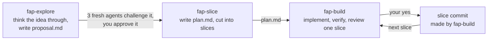
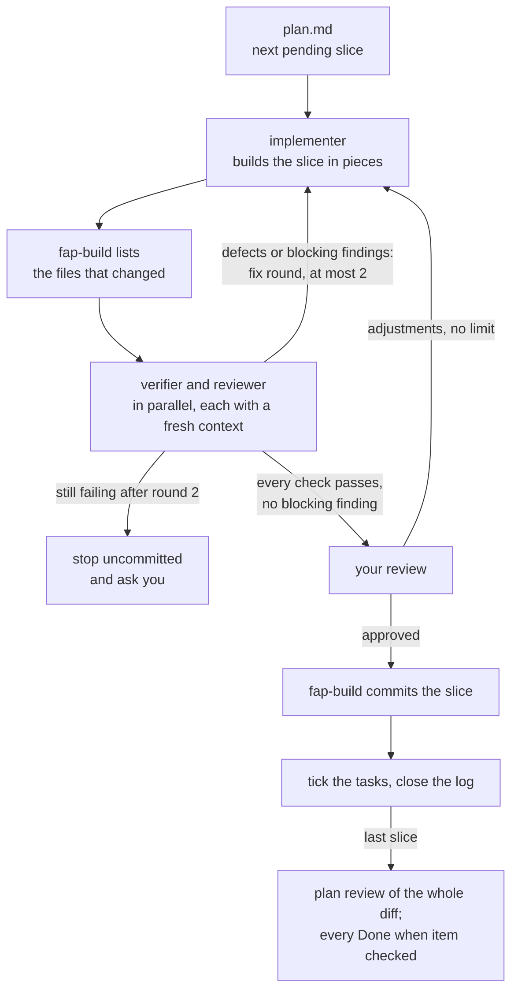
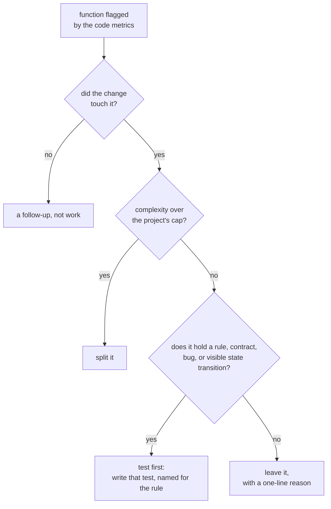

# Belay

Belay makes Claude Code or Codex build an idea as a series of small commits you have
actually read. A belayer holds the rope for a climber and never leaves the ground; here
every slice of code gets one, an agent that didn't write it and reruns every check before
you decide whether to commit.



Three things are different from letting an assistant run until it says it's done:

- **Nothing is built before the plan is challenged.** Three agents that weren't in the
  conversation read the proposal: one for what the project already has, one for what a
  reader who wasn't there can't follow, one for what the change would affect.
- **The agent that writes a slice never grades it.** A verifier with a fresh context
  reruns every check and writes down its evidence, and a reviewer reads the diff against
  the plan.
- **You approve one slice at a time.** Each slice ends in something you can see, and
  Belay commits it only after you've looked.

## A slice

A plan is a list of slices. Each one is small enough to read in one sitting and ends in
something you can see in the product, and every task carries the check that proves it.
This is what one looks like in `plan.md` (an illustration, not a real plan):

```markdown
### 1. Dark mode on the settings screen
- Tracer: the theme choice reaches every screen from one stored setting
- You will see: a Dark mode switch in Settings that recolors the app at once

- [x] 1.1 Store the theme choice with a light default.
  - Check: on the emulator, the choice survives an app restart.
- [ ] 1.2 Add the Dark mode switch to the settings screen.
  - Check: on the emulator, the switch recolors Settings in both themes.
```

The `Tracer:` line marks a slice that runs an assumption nobody has seen run yet: a new
integration, a library used for the first time, a path through every layer the change
touches. A tracer is the thinnest kept version of that path, built to the project's
quality bar, and it goes as early as its dependencies allow so the assumption is tested
before other slices build on it. It is also where to look hardest when you review. How
slices are cut, and when a plan has no tracer, is in
[slicing.md](skills/fap-slice/references/slicing.md).

## What happens to a slice

Each `fap-build` run builds the next pending slice and stops at your review.



- The implementer reports what it changed, but `fap-build` takes the file list from
  snapshots of the working tree, so every brief and the commit read the same list.
- Your review shows what changed, how to see it yourself, the verifier's evidence, and
  the reviewer's findings. An adjustment reruns the verifier on what it affects, and the
  reviewer too when you ask for it.
- After the last slice, a reviewer reads the whole plan's diff for simplification and
  reuse, and for where it departs from the proposal, and a verifier checks each Done
  when item against the product.

## Install

You need Claude Code or Codex, bash, git, and curl.

```bash
curl -fsSL https://raw.githubusercontent.com/felipearpa/belay/main/get.sh | bash
```

This clones the repository into `~/.belay` and opens a one-screen picker where you
tick the CLIs and the skills you want. Before it writes anything it lists
every file it would add, overwrite, or remove. Run the same command again to update.

The skills are linked, not copied, so keep the clone where it is. To manage
the clone yourself, clone it anywhere and run `./install.sh` from it; `./build.sh --check`
then exits 0 and prints "up to date" while the install matches your choice.

Installing part of it, installing into Codex, what `build.sh` writes into your home
folder, how an update finds the clone and when it stops, and the `CLAUDE_HOME`,
`CODEX_HOME`, and `BELAY_HOME` variables are in [docs/install.md](docs/install.md).
Read [what build.sh touches](docs/install.md#what-buildsh-touches) before you install.

## Your first idea

In a project, start with an idea:

```text
/fap-explore add a dark mode to the settings screen
```

It ends in `.fap/<slug>/proposal.md`: what is proposed and why, for you to read before
anything is built, challenged by the three fresh agents when you ask. Run `fap-slice`
with the slug to write the plan, then `fap-build` with the same slug once per slice. The
read-only agents can also be asked for directly ("use the fap-reviewer agent on the
current diff"); the implementer runs only inside `fap-build`. In Codex, run the skills
the way Codex runs skills.

Everything a plan needs lives next to it, so a later session resumes where the last one
stopped:

```text
.fap/dark-mode/
├── proposal.md        what is proposed and why: problem, outcome, approach, decisions, risks
├── plan.md            goal pointing at the proposal, done when, read first, environment, slices
├── design/            the agreed screens as images, when the plan changes what you see
├── log.md             per slice: state, implementer, verifier, reviewer, your review, commit
├── verification.md    every check with its evidence, written only by the verifier
├── verification/      captures the verifier saved as evidence, when a check needs them
└── snapshots/         working-tree snapshots and each slice's file list, git-ignored
```

fap-build commits only the slice's files, so whether `.fap/` is committed is up to you.

The agents know nothing about your project until you tell them; see
[Make it yours](#make-it-yours).

## The pieces

Everything Belay installs is a skill or an agent.
[docs/structure.md](docs/structure.md) draws how they fit together and suggests a
reading order.

The three skills are the flow in the first diagram. `fap-explore` thinks an idea through
with you and writes the proposal; it builds nothing. `fap-slice` turns a proposal, or a
goal, into `plan.md` and stops at your OK. `fap-build` builds the next pending slice,
waits for your review, then commits it and tracks progress under `.fap/<slug>/`.

The agents are leaf workers: none calls another. `fap-explore` starts the first three
to challenge a proposal; `fap-build` starts the other three for each slice and makes
the commit itself.

| Agent | What it does |
| --- | --- |
| `fap-reuse-finder` | Reads a proposal and the code it touches, and reports what the project already has that solves part of it or resembles it, and whether to extend that instead of building anew. Read-only. |
| `fap-fresh-reader` | Reads the proposal alone, with no code and no conversation, and reports what a reader who wasn't there can't follow, what it takes for granted, and the obvious alternative it doesn't weigh. Read-only. |
| `fap-impact-analyst` | Reads a proposal and the code it touches, and reports what the change would affect that the proposal doesn't say: stored data, existing flows, contracts, and the assumptions nothing has run yet, which become tracers. Read-only. |
| `fap-implementer` | Implements one slice in small pieces, building after each, and runs every check its tasks name. Reports status per task, files changed, checks run, and open questions. |
| `fap-verifier` | With a fresh context, reruns every check of a slice and returns pass or fail with evidence, and defects with a reproduction. Writes only the plan's `verification.md`. |
| `fap-reviewer` | Reads a slice's diff against its plan, or a whole plan's diff for simplification, reuse, and where it departs from the proposal, and groups what the code metrics flag as split, test first, or leave. Read-only. |

Each agent is an `agents/<name>/AGENT.md`; `agents/common.md` holds the contract they all
share, which `build.sh` inserts into each. Every agent runs on the session's model.

## Tests and metrics

A coverage target rewards tests written for the number. The agents add a test only when
the project's testing policy allows it, and when a project has none, only when the test
pins a domain rule, reproduces a bug that reached a user, guards a contract another
component depends on, or covers a state transition the user can see. Code metrics still
help: they point at functions that are complex and under-tested, and the policy decides
what each one gets. The tool Belay is used with is
[crapper](https://github.com/felipearpa/crapper), which scores every function by
complexity and coverage; a project names its metrics command in its `AGENTS.md`, the
implementer runs it after its checks, and the reviewer sorts each flagged function:



No test is ever added to lower a score.

## Make it yours

The agents are project-neutral and tool-neutral, so they learn a project from its
`AGENTS.md` or `CLAUDE.md`. Put there the build and test commands, the testing policy
(which tests are allowed and which never are), an optional code-metrics command with how
to read its output and what counts as flagged, the project's conventions, and links to
its docs. This repository's own
[AGENTS.md](AGENTS.md) is an example.

To add or change a skill or agent, see
[Extending it](docs/structure.md#extending-it).

## Credits

[crapper](https://github.com/felipearpa/crapper) is a fork of
[unclebob/crapper](https://github.com/unclebob/crapper) by Robert C. Martin.

## License

[0BSD](LICENSE). Use, copy, modify, and distribute any of it, for any purpose, with or
without credit.
