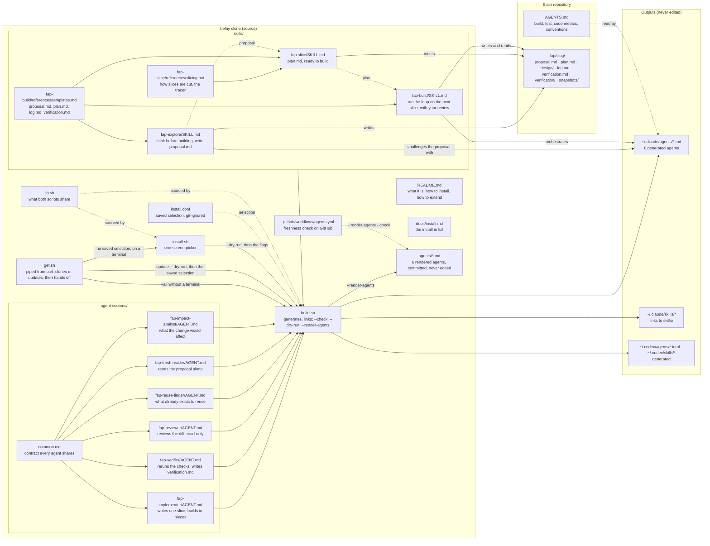
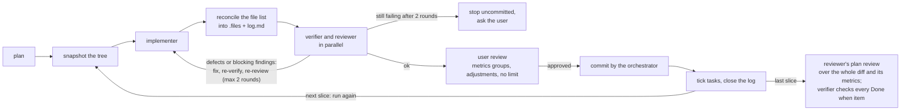

# Structure of Belay

A development system built on agents, shared by Claude Code and Codex. Your clone of this repository (`~/.belay` when `get.sh` made it) is the source of everything; `build.sh` generates what each CLI reads.

## What each file does

| File | What it does |
| --- | --- |
| `README.md` | What the system is and why it works this way, what a slice and a tracer are, one slice end to end, the one-line install, the pieces, tests and metrics, and how to make it yours. |
| `docs/install.md` | The install in full: where the clone goes, how an update finds it and when it stops, installing part of it, what `build.sh` writes into your home folders, the optional code-metrics tool, and Codex. |
| `get.sh` | The one-line install and update, fetched with curl and piped to bash. It takes the clone from `BELAY_HOME`, else from the `fap-*` skill links in `~/.claude/skills` and `~/.codex/skills`, else `~/.belay`, and says which. When that folder doesn't exist, it clones the repository (`BELAY_REPO`, else the GitHub URL) there, then runs the clone's `install.sh` with keys read from `/dev/tty` when there is a terminal, and `build.sh --all` when there isn't. When it exists, it fetches, fast-forwards the current branch from its upstream, then shows `build.sh --dry-run` for the selection in `install.conf`, waits for enter, and runs `build.sh`; without a terminal it runs `build.sh` without waiting. With no `install.conf` it opens `install.sh` on a terminal, and without one runs `build.sh --all` only when skill links already point into the clone. It stops before installing anything, with the clone's files, its HEAD and the homes unchanged (a fetch may have moved its remote-tracking refs), on uncommitted changes to tracked files, commits the upstream lacks, a diverged branch, a detached HEAD or a branch with no upstream, skill links into more than one clone, a folder that isn't a git clone, or a broken link where the clone should be. Not installed. |
| `install.sh` | The picker: one terminal screen listing the targets and the flow and each other skill, installed into each ticked CLI, with labels read from the sources. It opens on the selection in `install.conf` when there is one, else on what `build.sh` already installed in the homes (its agent files and skill links), else on the defaults. Enter shows the confirmation: the files `build.sh --dry-run` lists for the ticks, those marked overwrite, remove or new first, the unchanged ones as one count, cut to the terminal's width and scrolled with ↑↓ when they don't fit its height; a second enter runs `build.sh` with those flags, `b` goes back with the ticks, and `q` leaves without installing. Without a terminal it stops and points at `./build.sh --all` or the flags. |
| `build.sh` | Takes each `AGENT.md`, inserts `common.md` at the `{{common}}` line, and writes the generated files for Claude and Codex. Also links the skills into each CLI's skills folder. `--claude`, `--codex` and `--skills` choose a part and save it to `install.conf`; a later plain run reads that file, and `--all` installs everything without touching it. Each run removes what it installed earlier that is no longer chosen: skill links into the clone and its generated agent files; a real file or folder in the way is left and reported. With `--check` it only reports what is stale against the saved selection, or against everything with `--all`, and creates nothing. With `--dry-run` it lists each file the same run would touch as overwrite, remove, new or unchanged, in that order, then the notes the run would print and each home it leaves untouched, and writes nothing, `install.conf` included. An `install.conf` that doesn't read cleanly stops it before it writes anything. `--render-agents`, a maintainer's run, writes the finished Claude Code agents into `agents/` instead, one per source, removes a generated one whose source is gone, and writes nothing into the home folders or `install.conf`; a file there it didn't render is reported and left. With `--check` it writes nothing and exits 1 naming each file in `agents/` that is stale, missing, left from a removed source, or not rendered there. |
| `lib.sh` | What `install.sh` and `build.sh` both need, sourced by each: the flow's skills and the skill folders a selection installs, the list of optional skills, frontmatter parsing, how a path is shown, reading `install.conf`, each CLI's home, and how `build.sh`'s agent files and skill links are recognized. Not installed. |
| `install.conf` | The saved selection, two shell-sourceable lines: `targets` and `skills` (`flow` and optional skill names). Written by `build.sh` from its flags, git-ignored. Without it, `build.sh` installs everything. |
| `agents/*.md` | The six agents as `build.sh --render-agents` renders them for Claude Code, with `common.md` inserted, committed because the plugin loads them from git as they are. Each starts with a line naming `agent-sources/` as the place to edit. Never edited: after a source changes, rerun `--render-agents` and commit both. |
| `.github/workflows/agents.yml` | On every pull request and every push to `main`, runs `./build.sh --render-agents --check` on Linux with read-only permissions, so a commit whose `agents/` doesn't match its sources fails. It never commits. |
| `agent-sources/common.md` | What every agent follows: priorities (a brief never overrides the project's instruction files or your own rules), how it learns the project, how it returns questions, what it must not touch. |
| `agent-sources/fap-implementer/AGENT.md` | Builds one slice in pieces, building between pieces, and verifies what the brief names. |
| `agent-sources/fap-verifier/AGENT.md` | With a fresh context, reruns every check and device flow. The only agent that writes `verification.md`. |
| `agent-sources/fap-reviewer/AGENT.md` | Reviews a slice against its plan, or the whole diff at the end for simplification and for where it departs from the proposal. When the project has a code-metrics command, groups its flagged functions as split, test first (with the rule named), or leave. Never edits. |
| `agent-sources/fap-reuse-finder/AGENT.md` | Reads the proposal and the code it names and reports what already exists that solves part of it or resembles it, and whether to extend it. Read-only. |
| `agent-sources/fap-fresh-reader/AGENT.md` | Reads the proposal and nothing else, as the reader who wasn't in the conversation: paraphrases it, then reports what it can't follow, what is assumed, and the obvious alternative it doesn't weigh. Read-only. |
| `agent-sources/fap-impact-analyst/AGENT.md` | Reads the proposal and the code it names and reports what the change would affect that the proposal doesn't say (stored data, flows, contracts) and the assumptions nothing has run yet, for the tracers. Read-only. |
| `skills/fap-explore/SKILL.md` | The stance of thinking before building. Ends in `proposal.md`, which the three challenge agents read with a fresh context, the user reviews, and fap-slice plans from. |
| `skills/fap-slice/SKILL.md` | The slicer. Plans from a proposal or completes a goal, cuts the work into slices with their tracer in `plan.md`, checks the cut against the slicing rules, and stops at your OK. Builds nothing. |
| `skills/fap-build/SKILL.md` | The orchestrator. Runs implementer, verifier, and reviewer on the next pending slice, stops for your review, then commits and closes it. |
| `skills/fap-slice/references/slicing.md` | What a slice is, when the first one is a tracer, and which check each task carries. |
| `skills/fap-build/references/templates.md` | The templates for `proposal.md`, `plan.md`, `log.md`, and `verification.md`. |

## In your home folder

| Path | Origin |
| --- | --- |
| `~/.claude/agents/*.md` | Generated by `build.sh` from `agent-sources/` when the flow is chosen, and removed when it isn't. Never edited. |
| `~/.claude/skills/*` | Symlinks to the chosen `skills/*`: the flow's three with `flow`, each other by name. A link named after a skill and pointing at it in the clone is removed when that skill isn't chosen, and any link into the clone's `skills/` is removed once its skill no longer exists. |
| `~/.codex/agents/*.toml`, `~/.codex/skills/*` | The same for Codex. Continuing an agent that already did the work (fix rounds, adjustments) hasn't been tried in Codex; there the skills start a new agent of that role. |

## In each repository

| Path | Contents |
| --- | --- |
| `AGENTS.md` | Build and test commands, the testing policy (which tests are allowed, which never are, and what a function flagged by code metrics may get), an optional code-metrics command (crapper, or any tool whose output names each function with what it measured) with how to read that output and what counts as flagged, conventions, links to project docs. The agents receive it in their context; naming the tool and the policy only here is what keeps the agents project-neutral. |
| `.fap/<slug>/proposal.md` | What is proposed and why, written by fap-explore for a person to read before anything is built: problem (what exists today and for whom), outcome, approach, decisions with the options that lost, out of scope, risks (an assumption nothing has run yet marked `tracer candidate`), open questions, and a Status line (draft, challenged, approved). The challenge agents read it, fap-slice plans from it, and the plan review contrasts the code with it. |
| `.fap/<slug>/plan.md` | The whole plan: goal (problem and outcome, or a pointer at the proposal with its outcome), done-when items, decisions, out of scope, paths to read first, environment (devices, accounts, backend); then one section per slice, in build order, with the header bullets a person reads (tracer, you will see) and one-line tasks with a `Check` sub-bullet. Decisions taken during the build are appended here, so briefs never depend on a conversation. |
| `.fap/<slug>/design/*.png` | The agreed look for a plan that changes what the person sees: one render per screen or state, listed under Read first, named by the checks of the screen tasks. Saved by fap-explore when the look is approved there, or by fap-slice. |
| `.fap/<slug>/log.md` | Per slice: a `State` line a later session resumes from, implementer summary, verifier verdict, reviewer findings, commit, follow-ups. |
| `.fap/<slug>/verification.md` | Record of every check, and the final check of each Done when item, written by the verifier. |
| `.fap/<slug>/verification/` | Captures the verifier saves as evidence, when a check needs them; `verification.md` points to them. |
| `.fap/<slug>/snapshots/s<N>.*` | The orchestrator's snapshots, self-ignored by git: `.before` and `.after*` of the working tree, and `.files`, the slice's exact file list that every brief and the commit read. Deleted with the plan. |

## The loop per slice

## Extending it

1. Give each piece of guidance one home. What every agent follows is `common.md`; a
   role's contract and report format is its `AGENT.md`; workflow is a skill; what is
   true of one project only goes in that project's `AGENTS.md`.
2. Keep only guidance that changes a decision, add sources for technical claims, and
   distinguish preferences from platform requirements. Nothing here names a project.
3. Keep the prompts small. Every agent run pays for its whole prompt plus the project's
   instruction files.
4. Walk through one matching request and one unrelated request; confirm the guidance
   would not broaden the task.
5. Run the checks in [AGENTS.md](../AGENTS.md). They install with `--all` into temporary
   homes, so your saved choice doesn't change what they cover.

`install.sh` and `build.sh` read the sources and `install.conf` through `lib.sh`, which
both source; change what they share there, so the picker and the install stay in step.

## Suggested reading order

1. `README.md`
2. `skills/fap-slice/references/slicing.md` and `skills/fap-build/references/templates.md`
3. `skills/fap-explore/SKILL.md`, `skills/fap-slice/SKILL.md`, then `skills/fap-build/SKILL.md`
4. `agent-sources/common.md`
5. The six `AGENT.md` files
